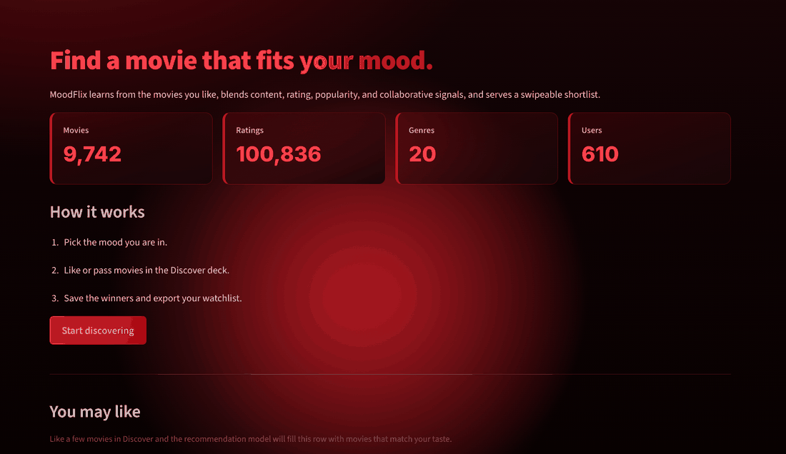

# MoodFlix

Mood-first movie discovery built with Streamlit, Pandas, and NumPy.

MoodFlix learns from the movies you like, blends content similarity, rating quality, popularity, collaborative signals, and mood match, then serves a swipeable shortlist.

## Features

- Mood-based discovery
- Swipe-style Like / Pass deck
- Content-based recommendations from genres
- Collaborative filtering from MovieLens ratings
- Search and genre filters
- Watchlist with CSV export
- Model insights and catalog statistics
- Session-only preferences (no accounts, no tracking)

## Preview



## Tech Stack

- Python
- Streamlit
- Pandas
- NumPy
- MovieLens Latest Small dataset

## Project Structure

```text
MoodFlix/
├── app.py
├── requirements.txt
├── README.md
├── assets/
│   ├── preview.gif
│   ├── home.png
│   ├── discover.png
│   └── insights.png
├── data/
│   ├── movies.csv
│   ├── ratings.csv
│   └── tags.csv
├── scripts/
│   └── download_data.py
└── src/
    ├── data_loader.py
    ├── mood.py
    ├── recommender.py
    └── ui.py
```

## Setup

Create and activate a virtual environment:

```powershell
python -m venv .venv
.venv\Scripts\Activate.ps1
```

Install dependencies:

```bash
pip install -r requirements.txt
```

The MovieLens data is included. To re-download it:

```bash
python scripts/download_data.py
```

Run the app:

```bash
streamlit run app.py
```

Open `http://localhost:8501`.

## How Recommendations Work

The score for each candidate movie is:

```text
45% content similarity
20% rating quality
10% popularity
15% collaborative signal
10% mood match
```

Content similarity compares genre profiles of liked movies with the catalog. The collaborative signal finds MovieLens users with similar taste based on the movies you liked.

## Data

MovieLens Latest Small dataset from GroupLens Research:

```text
https://grouplens.org/datasets/movielens/
```

## Team

- Khon Sotheara
- Cheang Youpheng
- Chea Sela
- Khann Udomvirak

## Roadmap

- Optional webcam mood detection with a manual fallback
- Movie posters through TMDB
- User accounts and SQLite persistence
- Precision@k and RMSE evaluation dashboard
- Deployment
